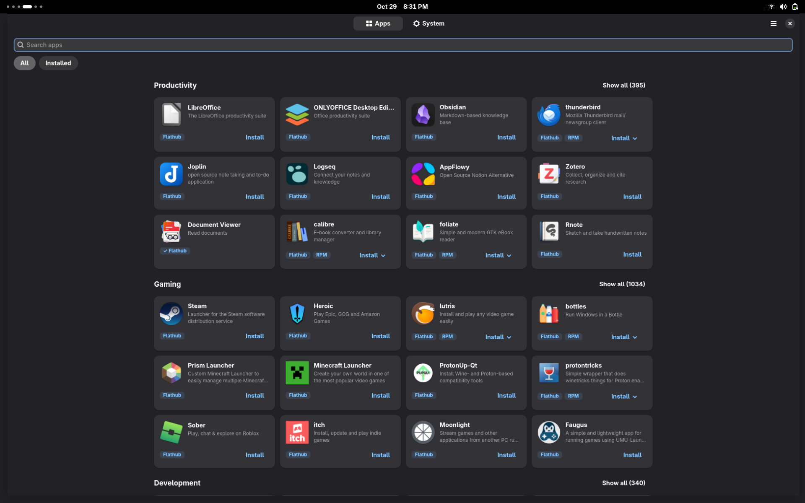
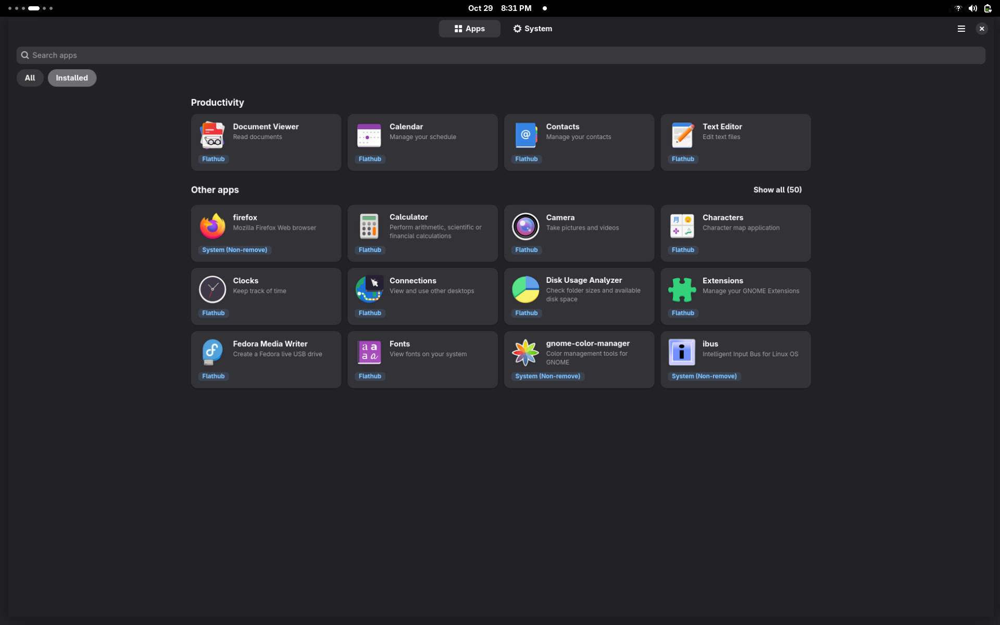
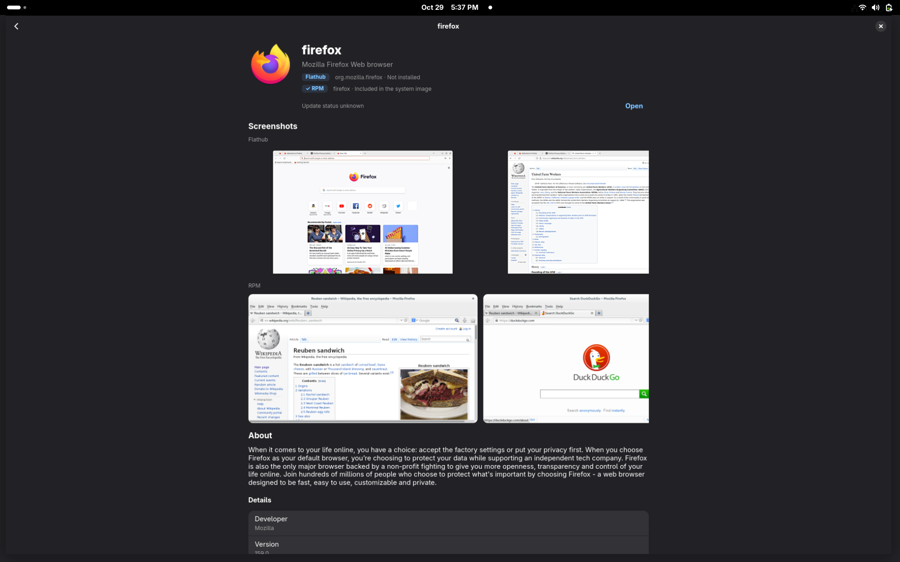
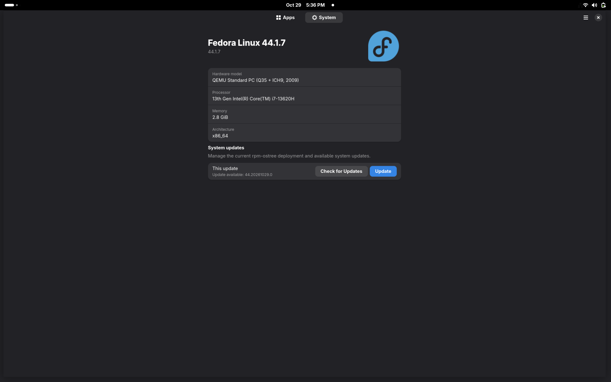

 <div align="center">
  

  # CW Software

  Software store for RPM-based atomic operating systems, with a unified interface to manage system packages, Flathub applications, and system updates.

  **[Download Latest RPM](https://github.com/carbonwarp/cw-software/releases/latest/download/cw-software-latest.rpm)**
</div>

Carbonwarp Software smartly manages refresh cycles for indexing, avoiding unnecessary updates to data that changes once in a blue moon while keeping frequently changing information reasonably up to date with a step of flexibility for triggering refreshes manually  whenever needed, ensuring they remain in control. Feeds are thoughtfully curated and presented with the user experience in mind, prioritizing relevance, usability, and convenience.

## Features

- **Atomic-First:** Designed specifically for atomic operating systems and their package management workflows.
- **Fast and Reliable:** A smooth and dependable software management experience.
- **Unified Management:** Manage system packages, sandboxed applications, and system updates in one place.


**Supported Platforms:** AlmaLinux Bootc, Fedora Atomic Desktops, and RHEL for Edge.

## Screenshots

<div align="center">
  
  <br />
  
  
  
</div>

## Installation

Download the latest RPM package:

**[Download cw-software-latest.rpm](https://github.com/carbonwarp/cw-software/releases/latest/download/cw-software-latest.rpm)**

You can also use the direct package URL:

```text
https://dl.carbonwarp.com/cw-software.rpm
```

## Build from Source

> Required: nfpm & An ASCII-armored GPG private key named `private.asc` at the repository root

### Build and Install

```bash
git clone https://github.com/carbonwarp/cw-software.git --depth 1
cd cw-software
make VERSION="1.4.3"
rpm-ostree install dist/*.rpm
```

## Contributing

Contributions are welcome. Both contributors and reviewers are expected to manually review changes before they are accepted.

By contributing to this project, you agree to license your contributions under the MIT License.

## License

CW Software is licensed under the MIT License. See the [LICENSE](LICENSE) file for details.
